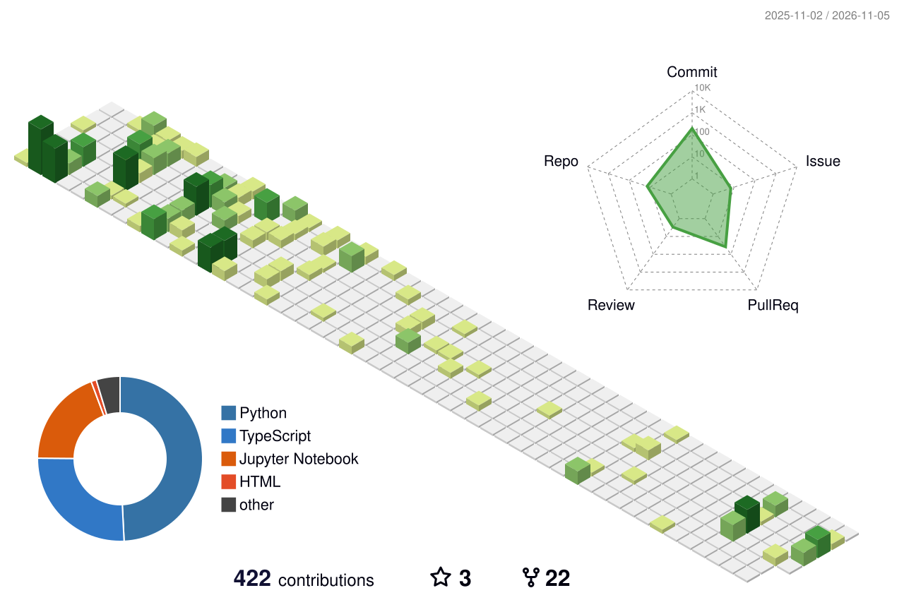

  

## Hi, I'm Yash 👋

**ML engineer working across LLMs, Reinforcement Learning, and Computer Vision, with CUDA to make them run fast.**

MSCS student at San José State University, building intelligent systems that can learn, reason, and act in unfamiliar environments.

## What I Work On

- **🧠 LLMs:** training, evaluation, and efficient inference of large language models; RAG systems
- **🎮 Reinforcement Learning:** model-based planning, world models, and intelligent agents
- **👁️ Computer Vision:** industrial inspection, detection, and multimodal learning
- **⚡ CUDA & GPU Systems:** GPU programming and inference optimization with TensorRT and ONNX

Previously, I worked on industrial computer vision, predictive maintenance, automated inspection, and inference optimization using ONNX and TensorRT.

## Featured Work

###  Echo
Communication-efficient world models for connected autonomous driving.

###  LEAP
An AI research project exploring learning, reasoning, and agentic behavior.

### Open Paper Lab
Implementations and experiments based on research papers I study.

## Tech Stack

## Contribution City

<picture>
  <source media="(prefers-color-scheme: dark)" srcset="profile-3d-contrib/profile-night-green.svg" />
  <source media="(prefers-color-scheme: light)" srcset="profile-3d-contrib/profile-green-animate.svg" />
  
</picture>

## Currently

- Pursuing an MSCS at San José State University
- Building projects across LLMs, RL agents and world models, and GPU-accelerated ML
- Seeking 2027 research engineering and machine learning engineering opportunities

## Let's Connect

💬 **Open to chat** about LLMs, RL, computer vision, CUDA, or 2027 research/ML engineering roles. Reach out anytime.

[Portfolio](https://yashkhairnar.com) · [LinkedIn](https://linkedin.com/in/yashkhairnar11)

